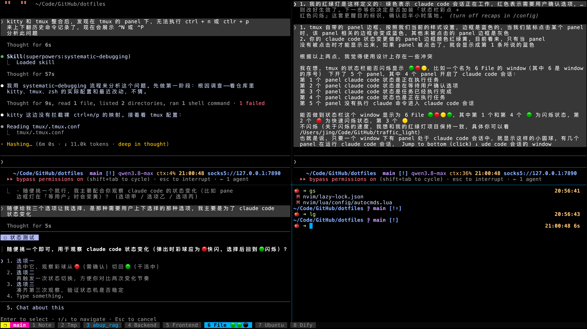

# dotfiles

个人开发环境配置仓库：macOS 本机与 Linux 远程服务器一键部署，以「kitty + tmux + Claude Code」多会话协作工作流为核心



## 这是什么

我的「开发环境全套源码」：终端、shell、编辑器、tmux、Claude Code 配置，外加配套的文件共享服务与键盘固件存档。同一份仓库按 `install.sh` 自动裁剪，落地两种形态——macOS 本机装全套（kitty、zsh、nvim、cursor、hammerspoon 等），Linux 远程服务器装最小集（tmux、nvim、starship、lazygit、yazi、claude 等）

最有特色的是 tmux + Claude Code 的多会话工作流：窗口管理全部交给 tmux，Cmd 快捷键免前缀直接驱动，且原样穿透 ssh 作用到远程；多个 claude 会话靠状态栏彩球、待办登记簿与 `clw` 任务接力协作。详见下文「工作流与快捷键」

## 亮点

1. **一键幂等部署**：`install.sh` 按操作系统自动裁剪链接集合，可重复执行；已正确的软链跳过、真实文件先备份再替换，`DRY_RUN=1` 可先演练
2. **跨机器路径无关**：仓库 clone 到任意路径均可，统一入口软链 `~/.dotfiles` 承担所有互相引用（hooks、CLAUDE.md import、tnew/clw），不同机器路径不同也零改动
3. **免前缀 tmux**：kitty 用 `send_text` 注入 tmux 前缀字节，物理 Ctrl-Space 留给 macOS 切输入法，两条通路互不干扰
4. **claude 会话可视化**：状态栏彩球实时显示各 pane 的 claude 状态（🟢 干活中 / 🔴 等确认 / 🟡 空闲），闪烁节奏与桌面实体 ESP32 红绿灯一致
5. **跨会话任务管理**：待办登记簿（状态栏 🔔N 全局计数）+ handoff skill 交接简报 + `clw` 拉起新 pane 接力，F2 弹出会话谱系树
6. **凭证不进库**：token 与模型环境变量外置 `~/.claude_env`（chmod 600），仓库内 settings.json 为消毒版
7. **内网文件共享**：dufs + systemd 用户级服务 + Tailscale，服务器上的页面产物 Mac 浏览器直接看

## 收录内容

| 目录 | 内容 | 平台 |
|---|---|---|
| `tmux/` | `.tmux.conf` 主配置（免前缀方案、彩球状态栏）+ `workspace/` 工作区加载器（`tnew` 后端） | 全部 |
| `kitty/` | 终端配置：`send_text` 快捷键映射（tmux 操作层）、tokyo-night 主题 | macOS |
| `zsh/` | `.zshrc`：tnew / claude 别名 / 凭证 source 等 | macOS |
| `nvim/` | 基于 LazyVim 的 Neovim 配置 | 全部 |
| `vim/` | `.vimrc` | 全部 |
| `claude/` | Claude Code：settings.json（消毒版）、CLAUDE.md、hooks、skills、`clw`/`clw-tree` 工具（详见 [claude/README.md](claude/README.md)） | 全部 |
| `starship/` | 跨 shell 提示符 | 全部 |
| `p10k/` | powerlevel10k 主题配置 | 全部 |
| `yazi/` | 终端文件管理器 | 全部 |
| `lazygit/` | git TUI 配置 | 全部 |
| `lazydocker/` | docker TUI 配置 | macOS |
| `cursor/` | Cursor 编辑器 settings 与 keybindings | macOS |
| `hammerspoon/` | macOS 桌面自动化 | macOS |
| `ideavim/` | JetBrains IDE 的 Vim 模拟 | macOS |
| `neovide/` | Neovide GUI 配置 | macOS |
| `dufs/` | `~/public` 文件共享的 systemd 用户级服务单元 | Linux |
| `niz/` | 宁芝键盘固件与键位映射存档（不参与安装） | — |
| `docs/` | 专题文档：tmux 工作流、远程服务器、dufs | — |

## 快速开始

### 1. clone 并安装

```bash
git clone git@github.com:KURANADO2/dotfiles.git ~/Code/GitHub/dotfiles
cd ~/Code/GitHub/dotfiles
./install.sh            # DRY_RUN=1 ./install.sh 可先演练
```

`install.sh` 会建立统一入口软链 `~/.dotfiles` 指向仓库实际位置，再按操作系统链接各配置；幂等可重复执行，真实文件先备份为 `.bak-<时间戳>` 再替换，绝不静默覆盖

Linux 远程服务器同样这三条命令（自动走最小集），但还需给 `~/.zshrc` 追加几行、并按需迁移旧 settings.json 的 env 块，完整步骤见 [docs/remote-server.md](docs/remote-server.md)

### 2. 创建 ~/.claude_env（必需，不在仓库内）

Claude Code 的凭证与模型环境变量存放在仓库外——**本仓库是公开的，token 绝不进库**。`install.sh` 链接的是消毒版 `claude/settings.json`（无 env 块），凭证由 zshrc 自动 source `~/.claude_env` 提供：

```bash
cat > ~/.claude_env << 'EOF'
export ANTHROPIC_AUTH_TOKEN='<你的token>'
export ANTHROPIC_BASE_URL='<你的端点>'
export ANTHROPIC_MODEL='<模型名>'
EOF
chmod 600 ~/.claude_env
```

更新 token 或切换模型直接编辑对应 export 行（模型映射还有 `ANTHROPIC_DEFAULT_OPUS/SONNET/HAIKU/FABLE_MODEL` 等可选变量）；改完后**新开的终端 / 新启动的 claude 会话**生效，运行中的会话沿用旧值、需重启

### 3. 进入工作区

```bash
tnew main        # 创建/打开 main 工作区，之后 Cmd 快捷键直接驱动 tmux
```

## 工作流与快捷键

### tmux 工作区（tnew）

- 不自动进 tmux：kitty 启动、`cmd+n` 新 OS 窗口、远程 ssh 登录都是裸 zsh，干活前手动 `tnew <名字>`（两边行为一致）
- `tnew <名字>`：会话已存在 → attach；不存在 → 按 conf 建好工作区再 attach；无 conf → 普通空会话
- `cmd+d` = detach：会话转后台持久运行，窗口回到裸 zsh 提示符（attach 不用 exec，窗口不关闭），再次 `tnew <名字>` 接回
- conf 查找顺序：`tmux/workspace/local/<名字>.conf`（**机器私有，不进仓库**）→ `tmux/workspace/<名字>.conf`（仓库通用版，如 `main.conf` 8 窗口布局）；conf 格式 = tmux 原生命令逐行书写

### 最常用快捷键

| 快捷键 | 功能 | 快捷键 | 功能 |
|---|---|---|---|
| `tnew <名字>` | 创建/打开工作区会话 | `cmd+d` | 脱离当前会话（转后台） |
| `cmd+t` | 新建窗口 | `cmd+w` | 关闭窗口（带确认） |
| `cmd+1..9` / `cmd+0` | 直达第 1~9 / 10 个窗口 | `cmd+p` | 最近用过的窗口 |
| `cmd+enter` | 右侧分屏（当前目录） | `cmd+shift+x` | 关闭当前 pane（带确认） |
| `cmd+shift+]` / `cmd+shift+[` | 下一个 / 上一个 pane | `cmd+shift+=` | 当前 pane 缩放开关 |
| `cmd+shift+h/j/k/l` | 调整 pane 大小（vim 式） | `cmd+shift+p` | 浮动 shell 浮层 |
| `F1` | 广播输入开关 | `F2` | claude 会话谱系树 |

完整快捷键表（含任意终端可用的前缀键用法、对应 tmux 命令与原生默认键）→ [docs/tmux.md](docs/tmux.md)

### Claude Code 协作

彩球状态、待办登记簿、`clw` 任务接力、handoff skill 的组件说明与生效方式 → [claude/README.md](claude/README.md)；给所有 claude 会话遵守的 tmux 编排约定 → [claude/CLAUDE.tmux.md](claude/CLAUDE.tmux.md)

### dufs 文件共享

服务器 `~/public` 目录经 dufs 共享在 Tailscale 上（仅 tailnet 内可见）：Claude 会话的 HTML 报告等页面产物统一写入 `~/public`，Mac 浏览器打开 `http://ubuntu.tail28c408.ts.net:5000` 即可浏览/搜索/拖拽上传/整目录下载。部署与代理注意事项 → [docs/dufs.md](docs/dufs.md)

## 环境要求

| 依赖 | 用途 | 必需 |
|---|---|---|
| tmux ≥ 3.3 | `allow-passthrough` 等特性（3.5a / 3.8 实测兼容） | 是 |
| python3 | 状态栏彩球守护进程、F2 谱系树 | 可选 |
| jq | claude statusline | 可选 |
| dufs 二进制 | `~/public` 文件共享（Linux，一次性手动安装） | 可选 |

settings.json 里的 traffic_light/osascript 等 hooks 带存在性守卫，机器上没有对应脚本时静默跳过

## 文档导航

| 文档 | 内容 |
|---|---|
| [docs/tmux.md](docs/tmux.md) | tnew 工作区机制、完整快捷键表、免前缀架构设计 |
| [docs/remote-server.md](docs/remote-server.md) | Linux 远程服务器部署步骤与环境要求 |
| [docs/dufs.md](docs/dufs.md) | `~/public` 文件共享服务部署与代理注意事项 |
| [claude/README.md](claude/README.md) | claude × tmux 协作组件（彩球/登记簿/接力） |
| [claude/CLAUDE.tmux.md](claude/CLAUDE.tmux.md) | 给 claude 会话的 tmux 编排约定与登记簿硬规则 |

## 日常维护

1. nvim 插件：Mac 上 `:Lazy update` 后提交 `lazy-lock.json`；服务器 pull 后只跑 `:Lazy restore` 对齐版本，不改 lockfile
2. kitty 配置：`ctrl+cmd+,` 热重载
3. 新增配置目录或改动快捷键语义时，同步更新本 README 与 `docs/` 对应文档
